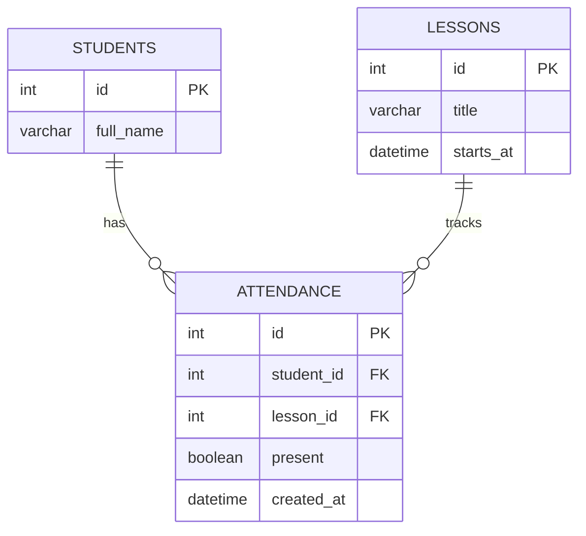

# Проектный практикум — трекер посещаемости

Учебный групповой проект по учёту посещаемости занятий. Цель — заменить разрозненные бумажные и ручные отметки единым сервисом с возможностью в будущем подключить мобильное приложение. Сейчас реализован минимальный backend-каркас с API и PostgreSQL; **готового мобильного приложения пока нет**.

## Команда

- **Гусаров А. — QA / DevOps**: репозиторий, ветки/PR, Docker Compose, PostgreSQL, автоматические тесты.
- **Backend / Mobile / ML**: ответственные пока не назначены в этом README. Состав команды и условия обмена ролями зафиксировать совместно в [docs/team.md](docs/team.md).

## Технологии

- Backend: **Python + FastAPI + SQLAlchemy**.
- База данных: **PostgreSQL 16**.
- Инфраструктура: **Docker + Docker Compose**.
- Тесты и CI: **pytest + GitHub Actions**.
- Мобильный клиент: технология не выбрана; заготовка находится в `mobile/`.
- ML: задача и ответственный пока не определены.

## Структура

```text
backend/       FastAPI, модели БД, pytest и Dockerfile
mobile/        место для мобильного клиента
demo/          сценарий демонстрации
docs/          архитектура, команда и ER-диаграмма
compose.yaml   запуск backend + PostgreSQL
.github/       CI: pytest на pull request
```

## Запуск (Docker)

Нужен установленный **Docker Desktop** или Docker Engine c Compose v2.

```bash
docker compose up --build
```

Затем открыть:
- http://localhost:8000/health — `{"status":"ok"}`.
- http://localhost:8000/health/db — проверка подключения к PostgreSQL.
- http://localhost:8000/docs — интерактивное Swagger API.

Остановка: `docker compose down` (данные БД сохраняются в named volume).

> Пароль в `compose.yaml` предназначен **только для локального учебного запуска**. Для публичного сервера настройте свои переменные в `.env` (не коммитьте его) и обеспечьте доступ только по HTTPS с авторизацией.

## Тестирование

```bash
cd backend
python -m pip install -r requirements-dev.txt
python -m pytest -q
```

Проверяется ответ `GET /health`. Дополнительные тесты API и БД команда добавит позднее.

## База данных (ER)



Подробности: [docs/er-diagram.md](docs/er-diagram.md).

## Git и Pull Request

- `main`: стабильная ветка. Изменения должны попадать **только через PR**.
- `develop`: ветка общей разработки.
- `feature/*`: рабочие ветки для конкретных задач.
- В Settings → Rules → Rulesets следует создать активное правило для `main`: **Require a pull request before merging**. Это делает владелец репозитория; наличие веток само по себе не защищает `main`.
- GitHub Actions запускает `pytest` при PR в `develop` и `main`.

Инструкция по публикации через ветки и Pull Request: [docs/github-setup.md](docs/github-setup.md).

## Демонстрация

См. [demo/README.md](demo/README.md): ссылка на репозиторий, запуск `docker compose up --build`, `GET /health`, `GET /health/db` и пример записи посещаемости через Swagger.

## Текущее состояние

**Сделано в каркасе:** структура, контейнеры, backend с API, простая схема БД, pytest и CI workflow. **Не сделано:** готовый мобильный клиент, ML-функции, вход пользователей, миграции и развёртывание на сервере.
