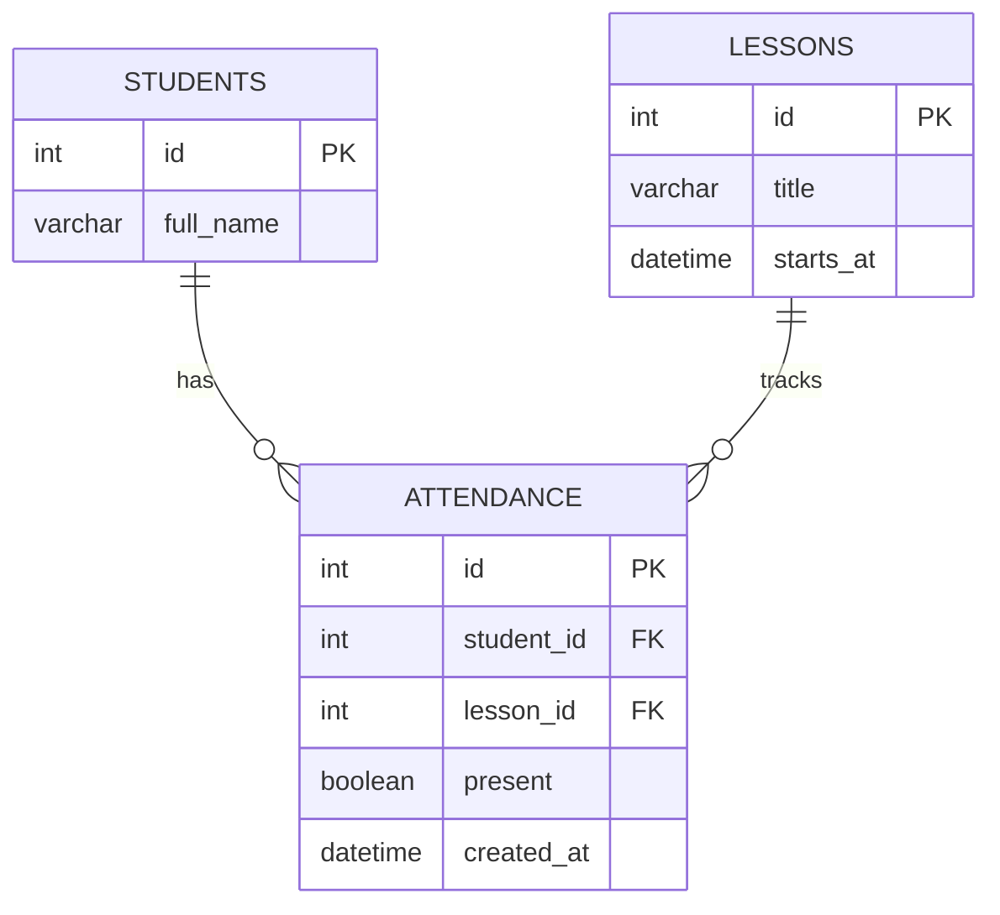

# Проектный практикум — трекер посещаемости

Учебный групповой проект по учёту посещаемости занятий. Цель — заменить разрозненные бумажные и ручные отметки единым сервисом с REST API и мобильным клиентом. В репозитории подготовлен минимальный backend на FastAPI, конфигурация PostgreSQL через Docker Compose и автоматические тесты. Мобильное приложение разрабатывается отдельно; его готовность и запуск с телефоном пока не подтверждены.

## Команда и роли

| Участник | Роль | Ответственность |
| --- | --- | --- |
| **Климов Н.** | Mobile | Нативное Android-приложение на Kotlin, интерфейс на Jetpack Compose, работа с REST API, сборка в Android Studio |
| **Сурков Г.** | Backend, БД и ML | API, модели и схема PostgreSQL, дальнейшая ML-функция |
| **Гусаров А.** | QA / DevOps | GitHub, ветки и Pull Request, Docker Compose, PostgreSQL в окружении разработки, pytest и GitHub Actions |

Подробнее о распределении ответственности: [docs/team.md](docs/team.md). Изменения ролей обсуждаются командой.

## Технологии и архитектура

- **Backend:** Python, FastAPI, SQLAlchemy, REST API.
- **База данных:** PostgreSQL 16.
- **Инфраструктура:** Docker и Docker Compose.
- **QA / CI:** pytest и GitHub Actions.
- **Мобильный клиент:** нативное Android-приложение на **Kotlin** с **Jetpack Compose**; сборка и запуск через **Android Studio**. Клиент обращается к REST API backend.
- **ML:** за постановку и выбор конкретной функции отвечает **Сурков Г.** Функция пока не выбрана и не реализована. Возможные направления для обсуждения: группа риска пропусков, обнаружение аномалий или аналитическая сводка.

### Почему выбран такой стек

Команда выбрала Kotlin, поскольку имеет опыт работы с этим языком. Нативная Android-разработка с Jetpack Compose подходит для интерфейса учёта посещаемости и проверки на реальном телефоне. Android Studio используется для сборки и отладки приложения. Разделение мобильного клиента и FastAPI-бэкенда через REST API позволяет разрабатывать и тестировать их независимо.

## Структура репозитория

```text
backend/       FastAPI, модели данных, тесты pytest и Dockerfile
mobile/        Android-клиент (Kotlin / Jetpack Compose): разрабатывается
demo/         сценарий показа и материалы демонстрации
docs/         архитектура, роли команды и ER-диаграмма
compose.yaml   запуск backend + PostgreSQL
.github/       GitHub Actions: тесты при Pull Request
```

## Запуск backend и базы данных

Нужен установленный Docker Desktop или Docker Engine с Compose v2. Из корня репозитория:

```bash
docker compose up --build
```

Затем на **ноутбуке** открыть:

- http://localhost:8000/health — ожидается `{ "status": "ok" }`;
- http://localhost:8000/health/db — проверка соединения с БД;
- http://localhost:8000/docs — Swagger UI.

Остановка: `docker compose down` (данные PostgreSQL остаются в Docker volume).

> Примечание: это инструкция по запуску; успешный запуск Docker и PostgreSQL на демонстрационном компьютере требуется отдельно проверить. Значения паролей в `compose.yaml` предназначены только для локальной разработки; не публикуйте реальные пароли или файл `.env`.

## Демонстрация мобильной части

- **Вариант А — основной:** живой Android-телефон и ноутбук подключены к **одной сети Wi-Fi**. На ноутбуке запущены backend и PostgreSQL. Мобильный клиент обращается к API по адресу `http://<IP-ноутбука>:8000`.
- **Вариант Б — резервный:** видеозапись демонстрации Android-приложения хранится в `demo/` после её подготовки.

**Что необходимо проверить перед демонстрацией:** сейчас `compose.yaml` публикует порт как `127.0.0.1:8000:8000`, то есть API доступен только с самого ноутбука. Для доступа с телефона потребуется настроить публикацию порта в локальной сети, разрешения брандмауэра и HTTP-доступ в отладочной конфигурации Android, затем протестировать соединение. Пока это не выполнено, вариант А является **планом**, а не подтверждённым результатом. Видеозапись варианта Б тоже требуется подготовить. Подробности: [demo/README.md](demo/README.md).

## База данных и ER-диаграмма

В **текущем backend-прототипе** описаны три таблицы: `students`, `lessons`, `attendance`.



**Требование следующего этапа — не менее пяти таблиц.** Для расширенной схемы запланированы **шесть** сущностей: `users`, `groups`, `students`, `subjects`, `lessons`, `attendance`. За реализацию обновлённой схемы БД отвечает **Сурков Г.** После внесения изменений в модели и БД потребуется актуализировать ER-диаграмму здесь и в [docs/er-diagram.md](docs/er-diagram.md). До этого диаграмма выше показывает **фактически существующую начальную схему**, а не готовые шесть таблиц.

## Тестирование

```bash
cd backend
python -m pip install -r requirements-dev.txt
python -m pytest -q
```

Автоматическая проверка GitHub Actions выполняет тест `GET /health` при Pull Request в `develop` и `main`. Тесты API с реальной PostgreSQL, мобильного клиента и расширенной схемы БД будут добавлены по мере разработки.

## Работа с GitHub

- `main` — стабильная ветка, изменения переносятся через Pull Request; защита ветки включена.
- `develop` — ветка общей разработки.
- `feature/*` — ветки отдельных задач.
- Перед объединением изменений проверяем результаты GitHub Actions и просматриваем файлы.

Инструкция: [docs/github-setup.md](docs/github-setup.md).

## Текущий статус и следующие задачи

**Подготовлено:** публичный репозиторий, ветки и Pull Request, README, структура проекта, backend-каркас, Docker Compose, текущие модели трёх таблиц, pytest и GitHub Actions.

**Далее:** Сурков Г. расширяет БД до шести таблиц и определяет ML-задачу; Климов Н. разрабатывает Android-клиент; Гусаров А. проверяет запуск Docker/PostgreSQL, интеграцию API, сетевой доступ с телефона и сценарий демонстрации. После изменения БД обновляем ER-диаграмму и тесты.
