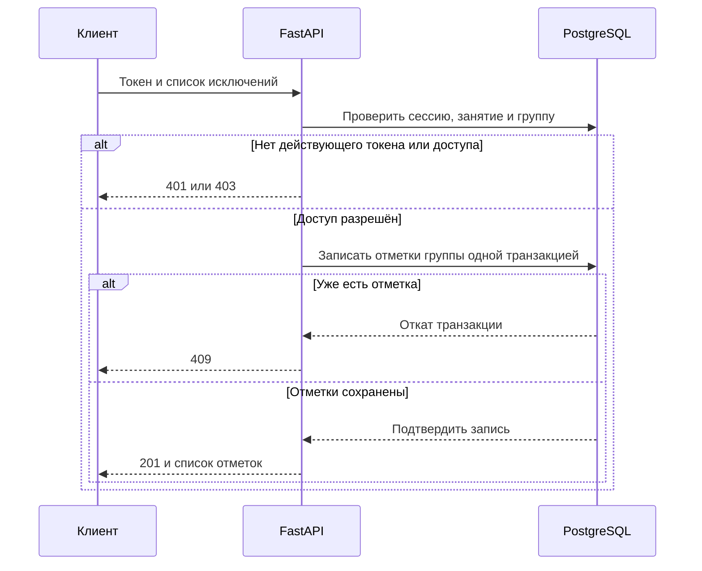

# Архитектура трекера посещаемости

- Android-клиент использует Kotlin и Jetpack Compose. Контракт FastAPI доступен в Swagger UI по пути `/docs`.
- FastAPI принимает HTTP-запросы, проверяет входные данные и права пользователя. SQLAlchemy сохраняет справочники, занятия, отметки и данные о доступе.
- Docker Compose запускает API и PostgreSQL 16. Для локальных тестов используется SQLite с включёнными внешними ключами.
- При запуске приложение создаёт недостающие таблицы и добавляет новые nullable-колонки для базы предыдущего спринта. Демонстрационные данные загружаются при создании администратора.

## Запрос массовой отметки

Права проверяются по данным базы. Студент получает свои отметки, статистику и прогноз. Преподаватель и староста работают с назначенными группами. Администратор управляет всеми группами, предметами и аккаунтами.

[ER-диаграмма](er-diagram.md) · [API и формула статистики](../README.md#api-спринта-2) · [Логистическая регрессия](ml_plan.md)
