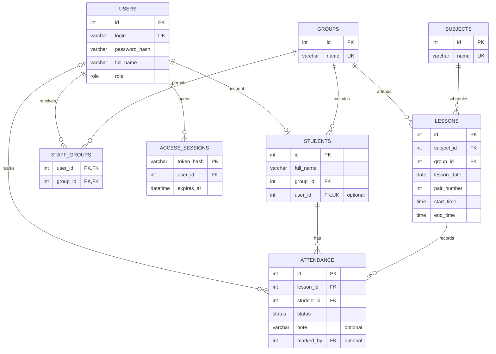

# ER-диаграмма базы данных

Диаграмма описывает модели SQLAlchemy после спринта 2. Схему можно импортировать в dbdiagram.io из [schema.dbml](schema.dbml).

- Для занятий уникальна комбинация `(group_id, lesson_date, pair_number)`.
- Для посещаемости уникальна пара `(lesson_id, student_id)`. Внешние ключи защищают занятие и студента от удаления, пока у них есть отметки.
- `user_id` студента может быть пустым, например у записи после импорта CSV. Администратор может создать аккаунт позднее.
- `staff_groups` связывает преподавателя или старосту с доступными группами. `access_sessions` хранит хеш токена и срок действия.
