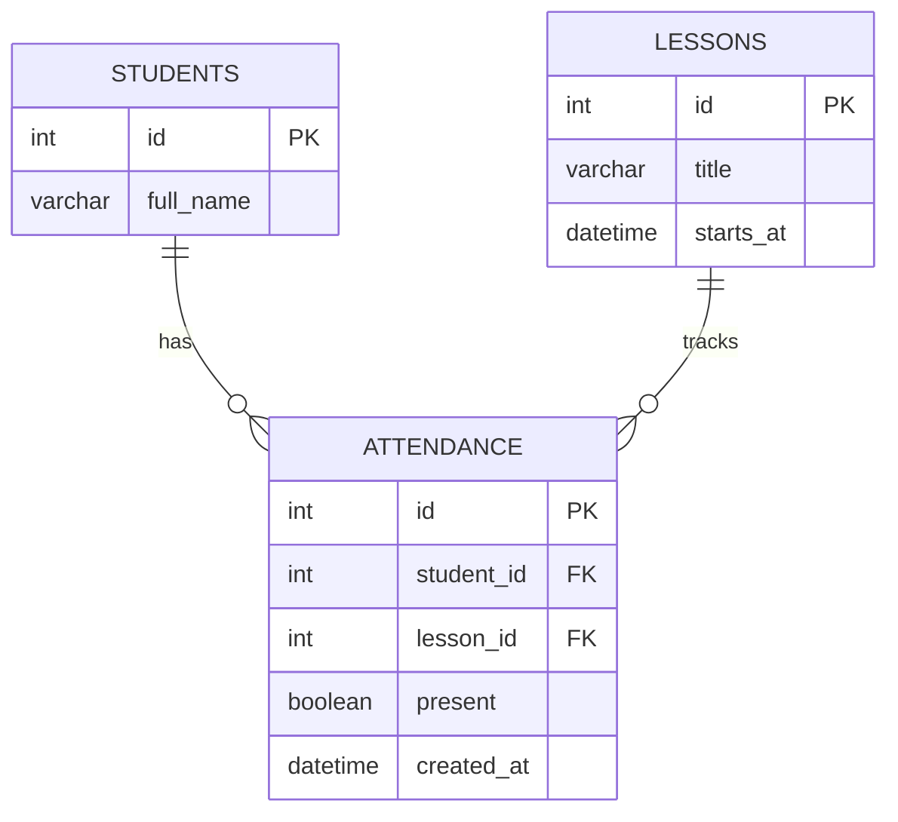

# ER-диаграмма базы данных

Это **начальная схема** учебного прототипа. Позже команда может добавить группы, преподавателей и пользователей.

Ограничение уникальности `(student_id, lesson_id)` не позволяет добавить две отметки для одного студента на одном занятии.
